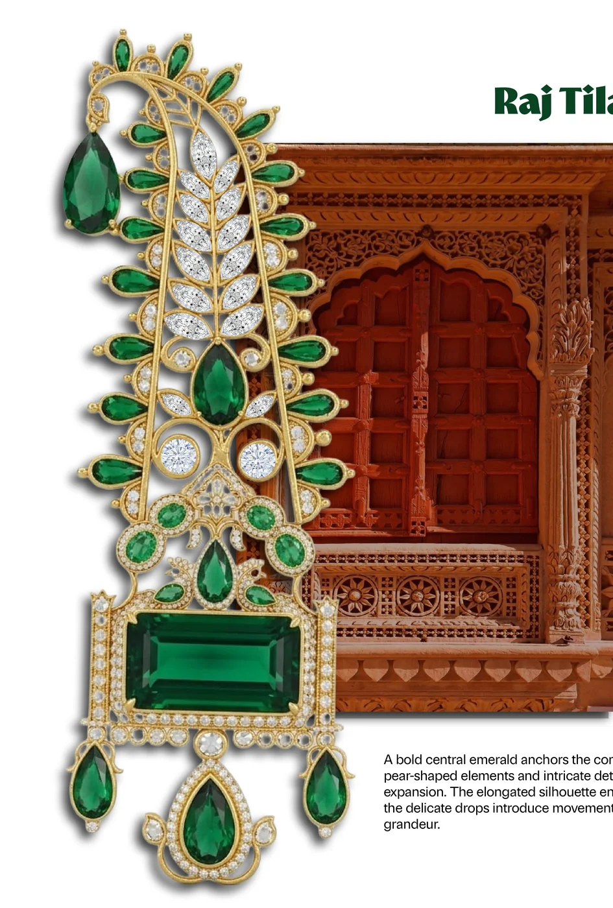

# Soumi Mukherjee | Jewelry & Lifestyle Accessories Design Portfolio 💎

Official digital portfolio for **Soumi Mukherjee**, B.Des Final Year (7th Jury / Placement Candidate), Department of Fashion & Lifestyle Accessories (F&LA) at the **National Institute of Fashion Technology (NIFT), Kolkata**.



---

## 🌟 Featured Signature Collections

1. **VersaForma (Collection 01)** — *The Art of Transformable Adornment*
   - Victorian elegance reinterpreted through modern modularity.
   - Convertible royal necklace transforming into a bridal Maang Tikka.
   - 3-tier modular stud-to-drop earrings, articulated hathphool slave bracelet, and geometric cluster rings.

2. **Rajdwara (Collection 02)** — *Sculpting Heritage into Masculine Elegance*
   - Contemporary men's luxury jewellery translating Rajasthani palatial architecture (pols, torans, arches, jaalis).
   - The modular *Raj Tilak Kalangi* royal head crest with rail-slot docking system.
   - 3 detachable brooches: *Pravesh Stambh*, *Megh Toran*, and *Surya Pol* with Colombian emeralds and 18K yellow gold.

3. **अंतर्ज्योति Antarjyoti (Collection 03)** — *The Seven Vital Energies*
   - High-jewelry bangles (*Sahasrara* and *Padma*) inspired by the Sacred Geometry of the Lotus and 7 chakra alignment.
   - Modeled on traditional alta-painted mudra hands.
   - Sieve and millimeter stone specification charts with GH-VS diamonds, multi-color gemstones, and hanging natural pearls.

4. **NaadRaga (Collection 04)** — *The Rhythm of Resonance*
   - Classical Indian acoustic instruments (tanpura, sitar, sarod) inspiring fluid metallic resonance and lifestyle adornment.

---

## 🚀 How to Host on GitHub Pages (In 2 Minutes)

This portfolio is built with zero dependencies (pure HTML5, CSS3, and modern Vanilla JS), making it instantly deployable on **GitHub Pages for free**:

### Step 1: Create a GitHub Repository
1. Log in to [GitHub](https://github.com).
2. Click **New Repository** (e.g., `soumi-portfolio` or `soumimukherjee.github.io`).
3. Leave it Public and do not initialize with README or license.

### Step 2: Push Your Code
Open your terminal in this directory (`d:\SOUMI PROTFOLIO`) and run:
```bash
git remote add origin https://github.com/<YOUR_GITHUB_USERNAME>/<YOUR_REPOSITORY_NAME>.git
git branch -M main
git push -u origin main
```

### Step 3: Enable GitHub Pages
1. In your GitHub repository, click **Settings** (top tab).
2. On the left sidebar, click **Pages**.
3. Under **Branch**, select `main` and root folder `/ (root)`, then click **Save**.
4. Within 60 seconds, GitHub will give you your live URL:
   `https://<YOUR_GITHUB_USERNAME>.github.io/<YOUR_REPOSITORY_NAME>/`

You can now paste this live link directly into your LinkedIn profile, Behance bio, CV, and college online placement forms!

---

## 📂 File Structure

```text
├── index.html                   # Main semantic single-page web portfolio
├── styles.css                   # Custom luxury design system & responsive layout
├── app.js                       # Interactive logic (tabs, flipbook, sparkles, modals)
├── Soumi_Mukherjee_Resume.pdf   # Downloadable official resume
├── Soumi_Mukherjee_Portfolio.pdf# Downloadable full jury portfolio (original PDF)
├── assets/
│   ├── avatars/                 # Authentic sticker cutout avatars of Soumi
│   ├── showcase/                # High-resolution crops of jewelry pieces & renders
│   └── pages_web/               # All 21 high-res jury spreads for the Flipbook reader
└── README.md                    # Project documentation & deployment guide
```

---

## 📬 Contact & Industry Placements

- **Email**: [soumimukherjee1044@gmail.com](mailto:soumimukherjee1044@gmail.com)
- **Phone**: +91 9163235165
- **LinkedIn**: [linkedin.com/in/soumi-mukherjee-93ab66293](https://www.linkedin.com/in/soumi-mukherjee-93ab66293)
- **Behance**: [behance.net/soumimukherjee3](https://www.behance.net/soumimukherjee3)
- **Location**: Kolkata, India
